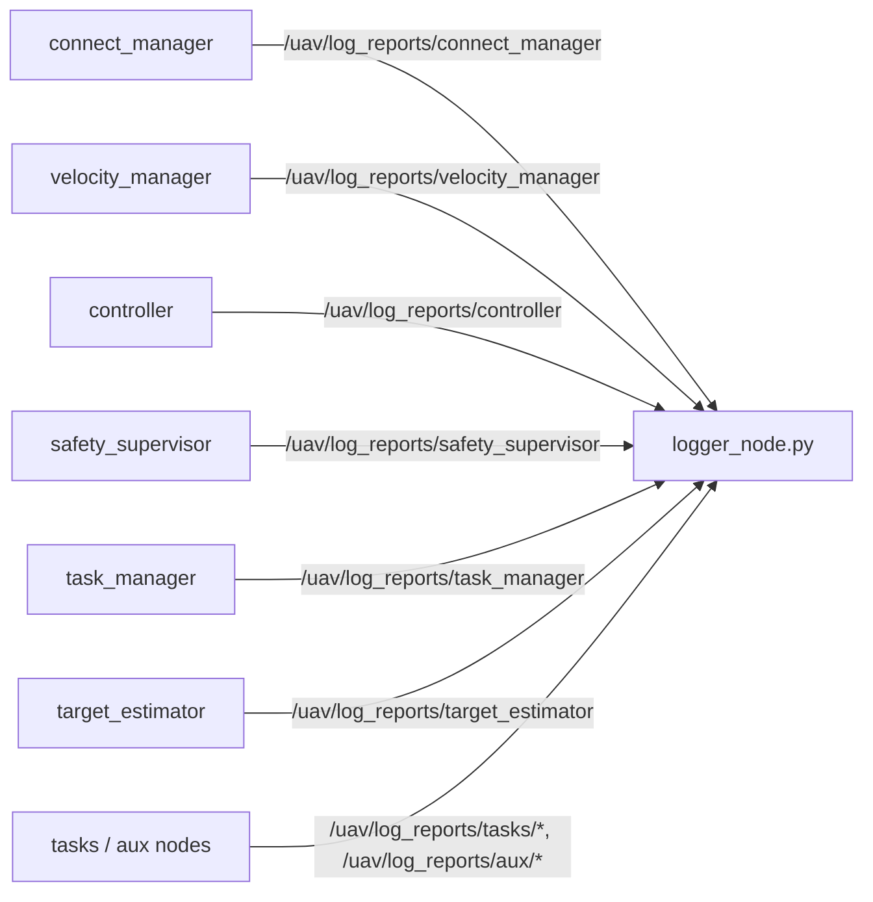

# lite_quad_uav

ROS1 Noetic + MAVROS + PX4 SITL 下的轻量四旋翼控制框架。当前包的主目标是打通一个最小闭环：

```text
PX4/MAVROS -> reliable connected -> setpoint stream ready -> 任务请求 OFFBOARD/ARM -> 生成位置参考 -> PID 生成候选速度 -> 速度管理层发布 MAVROS setpoint
```

`connect_manager_node` 启动后只负责连接健康检查、setpoint stream 前置检查，以及通用车辆命令代理。任务启动由 `task_manager_node` 统一入口触发；矩形任务会在自身流程中请求 `SET_MODE OFFBOARD` 和 `ARM`。

## 节点作用

| 节点 | 作用 |
|------|------|
| `connect_manager_node` | 连接/命令代理。检查 MAVROS service、FCU connected、local position、velocity manager setpoint stream，发布 `/uav/vehicle/status`，并代理 `SET_MODE/ARM/DISARM`。 |
| `velocity_manager_node` | 唯一常规 MAVROS 速度 setpoint 出口。订阅候选速度 `/uav/control/candidate_velocity`，经过 watchdog、safety、限幅后发布到 `/mavros/setpoint_velocity/cmd_vel_unstamped`。 |
| `controller_node` | 控制器调度节点。订阅任务层 `/uav/control/request`，转换为内部 `ControllerCommand`，当前 `REFERENCE_TRACKING/HOLD` 走 PID 位置控制并输出候选速度。 |
| `safety_supervisor_node` | 安全监督节点。监控 MAVROS 连接、电池、本地位置和 velocity manager watchdog，发布 `/uav/safety/status`。 |
| `task_manager_node` | 任务管理入口。注册多个任务节点，提供 `/uav/task_manager/start_task` 和 `/uav/task_manager/control_task`，当前是单 active task 模式。 |
| `square_patrol_task_node` | 矩形巡航任务。状态机为 `IDLE -> PRECHECK -> MODE_REQUEST -> MODE_WAIT_CONFIRM -> ARM_REQUEST -> ARM_WAIT_CONFIRM -> TAKEOFF -> PATROL`，通过 `/uav/control/request` 发布位置参考。 |
| `hover_placeholder_task_node` | 占位任务节点，提供标准 task 接口，不参与飞控控制。 |
| `inspection_placeholder_task_node` | 占位任务节点，提供标准 task 接口，不参与飞控控制。 |
| `logger_node.py` | 集中日志节点。订阅 `/uav/log_reports/...`，缓存最新 report，并按固定频率统一打印，避免各节点刷屏。 |
| `target_estimator_node` | 通用 AprilTag 识别结果整理节点。订阅 `apriltag_ros` 检测结果，在飞控可靠连接后输出 `/uav/sensing/apriltag_target`。 |
| `target_detector_node.py` | 目标检测占位节点。当前只发布最小日志 report。 |
| `gcs_bridge_node.py` | 地面站通信占位节点。当前只发布最小日志 report。 |

`Action` 类库不是 ROS 节点，位于 `include/lite_quad_uav/tasks/actions.hpp` 和 `src/libraries/actions/actions.cpp`，供任务节点生成 `ControlRequest`。

## Launch 分层

`uav_core_start.launch` 启动飞控核心链路：MAVROS（可关闭）、`connect_manager_node`、`safety_supervisor_node`、`controller_node`、`velocity_manager_node`、`task_manager_node` 和 `logger_node.py`。

具体任务节点不放在 core launch 中；`square_patrol.launch` 会 include core launch，并额外启动 `square_patrol_task_node`、`hover_placeholder_task_node` 和 `inspection_placeholder_task_node`。

感知/辅助节点也不随 core launch 默认启动：AprilTag 检测和目标整理可用 `target_estimator_test.launch` 单独启动；`continuous_detection.launch` 保留为只启动 AprilTag 检测的入口。

## 程序结构框图

```mermaid
flowchart LR
    PX4[PX4 SITL / FCU]
    MAVROS[MAVROS]

    CM[connect_manager_node]
    SS[safety_supervisor_node]
    VM[velocity_manager_node]
    CTRL[controller_node]
    TM[task_manager_node]
    TASK[square_patrol_task_node]
    ACT[Action: Takeoff / Waypoint / Hold]

    PX4 <--> MAVROS
    MAVROS -->|/mavros/state| CM
    MAVROS -->|/mavros/local_position/pose| CM
    CM -->|/uav/vehicle/status| VM
    CM -->|/uav/vehicle/status| TM
    CM -->|/uav/vehicle/status| TASK

    MAVROS -->|state / battery / pose| SS
    VM -->|/uav/control/velocity_manager_status| SS
    SS -->|/uav/safety/status| VM

    TM -->|/uav/tasks/square_patrol/start| TASK
    TASK --> ACT
    ACT -->|/uav/control/request| CTRL
    CTRL -->|/uav/control/candidate_velocity| VM
    CTRL -->|/uav/control/controller_feedback| TASK
    VM -->|/mavros/setpoint_velocity/cmd_vel_unstamped| MAVROS

    TASK -->|/uav/vehicle/command SET_MODE / ARM| CM
    CM -->|/mavros/cmd/arming, /mavros/set_mode| MAVROS
```



日志链路独立于控制链路：



## 核心消息和服务

### 控制闭环消息

| Topic | Type | 方向 | 说明 |
|-------|------|------|------|
| `/uav/vehicle/status` | `VehicleStatus` | `connect_manager_node -> task_manager / task / velocity_manager` | 可靠连接、setpoint stream 前置条件、当前 mode、armed。 |
| `/uav/control/request` | `ControlRequest` | `task node -> controller_node` | 任务层主控制接口，包含 `source_task`、`source_action`、`mode`、参考位置、速度/角速率约束。 |
| `/uav/control/candidate_velocity` | `VelocityCommand` | `controller_node -> velocity_manager_node` | 控制器输出的候选速度，不直接写 MAVROS。 |
| `/uav/control/velocity_manager_status` | `PipelineStatus` | `velocity_manager_node -> connect_manager / safety_supervisor` | velocity manager 状态、watchdog、命令来源和命令年龄。 |
| `/uav/control/controller_feedback` | `ControllerFeedback` | `controller_node -> task node` | 控制器状态、误差、收敛、限幅、fallback 等反馈。 |
| `/uav/safety/status` | `SafetyStatus` | `safety_supervisor_node -> velocity_manager_node` | 安全等级、是否允许飞行、原因。 |
| `/uav/sensing/apriltag_target` | `AprilTagTargetArray` | `target_estimator_node -> sensing consumers` | 当前检测/跟踪到的 AprilTag 列表，包含每个 tag 的原始机体系位姿、IMU 补偿后的 level 坐标、滤波坐标、置信度和状态。 |
| `/uav/tasks/<task_id>/status` | `TaskStatus` | `task node -> task_manager` | 单个任务节点状态，包含 `task_state`、`task_progress`、active action。 |
| `/uav/task_manager/status` | `TaskManagerStatus` | `task_manager -> external monitor` | 任务管理器汇总状态，包含 `node_state`、当前 active task、注册任务列表和车辆 ready 门控。 |

核心字段摘要：

| Type | 关键字段 |
|------|----------|
| `VehicleStatus` | `connected`、`ready`、`mode`、`armed`、`message` |
| `ControlRequest` | `source_task`、`source_action`、`mode`、`reference_position`、`reference_yaw`、`max_xy_speed/max_z_up_speed/max_z_down_speed/max_yaw_rate`、`valid` |
| `VelocityCommand` | `source`、`vx/vy/vz/yaw_rate`、`valid`、`controller_name`、`message` |
| `PipelineStatus` | `state`、`command_source`、`watchdog_active`、`last_command_age_sec`、`message` |
| `ControllerFeedback` | `state`、`position_error_norm`、`converged`、`saturated`、`source_task/source_action`、`fallback_active` |
| `AprilTagTargetArray` | `source_frame`、`camera_frame`、`body_frame`、`level_frame`、`target_count`、`detected_tag_ids`、`targets[]` |
| `AprilTagTarget` | `tag_id`、`state`、`detected`、`pose_valid`、`pose_body_raw`、`position_level_raw`、`position_level_filtered`、`confidence`、`detection_age`、`imu_age`、`residual_norm`、`stable_count`、`lost_count` |
| `TaskStatus` | `task_name`、`task_state`、`task_progress`、`active_action`、`message` |
| `TaskManagerStatus` | `node_state`、`busy`、`accepting_new_task`、`active_task_id`、`active_task_state/progress`、`registered_task_ids`、`vehicle_ready`、`message` |

任务层主控制接口是 `ControlRequest`；控制器内部调度结构不作为 ROS 消息对外发布。

### 服务接口

| Service | Type | 说明 |
|---------|------|------|
| `/uav/task_manager/start_task` | `StartTask` | 统一任务启动入口。常用 `task_type: 'square_patrol'`。 |
| `/uav/task_manager/control_task` | `ControlTask` | 统一任务控制入口，支持 `PAUSE`、`RESUME`、`CANCEL`。 |
| `/uav/tasks/<task_id>/start` | `StartTask` | 具体任务节点内部入口，通常由 task manager 调用。 |
| `/uav/tasks/<task_id>/control` | `ControlTask` | 具体任务节点内部控制入口，通常由 task manager 调用。 |
| `/uav/vehicle/command` | `VehicleCommand` | 车辆命令入口，支持 `PREPARE`、`SET_MODE`、`ARM`、`DISARM`。矩形任务会调用 `SET_MODE OFFBOARD` 和 `ARM`。 |

### 日志 report 消息

日志 report 只用于监控和打印，不参与飞控闭环：

| Topic | Type |
|-------|------|
| `/uav/log_reports/connect_manager` | `ConnectManagerLogReport` |
| `/uav/log_reports/velocity_manager` | `VelocityManagerLogReport` |
| `/uav/log_reports/controller` | `ControllerLogReport` |
| `/uav/log_reports/safety_supervisor` | `SafetySupervisorLogReport` |
| `/uav/log_reports/task_manager` | `TaskManagerLogReport` |
| `/uav/log_reports/target_estimator` | `TargetEstimatorLogReport` |
| `/uav/log_reports/tasks/<task_id>` | `TaskNodeLogReport` |
| `/uav/log_reports/aux/<node_id>` | `TaskNodeLogReport` |

## 关键流程

### 连接和命令待机

```text
INIT_WAIT_MAVROS
  -> LINK_WAIT_FCU_CONNECTION
  -> LINK_WAIT_LOCAL_POSITION
  -> STREAM_WAIT_SETPOINT_STREAM
  -> COMMAND_READY
```

`VehicleStatus.connected=true` 表示 MAVROS state 新鲜、FCU connected 且 local position 新鲜。`VehicleStatus.ready=true` 表示在 `connected=true` 的基础上，velocity manager 正在持续发布 setpoint stream，可由任务请求模式切换；它不表示当前已经是 OFFBOARD。

### 矩形任务

```text
IDLE
  -> PRECHECK
  -> MODE_REQUEST
  -> MODE_WAIT_CONFIRM
  -> ARM_REQUEST
  -> ARM_WAIT_CONFIRM
  -> TAKEOFF
  -> PATROL
```

矩形航点以任务启动前的本地位置为原点：

```text
P0 = (origin_x,        origin_y,        flight_altitude)
P1 = (origin_x + side, origin_y,        flight_altitude)
P2 = (origin_x + side, origin_y + side, flight_altitude)
P3 = (origin_x,        origin_y + side, flight_altitude)
```

## 编译

```bash
cd ~/code/catkin_ws
source /opt/ros/noetic/setup.bash
catkin_make --pkg lite_quad_uav
source devel/setup.bash
```

## 仿真测试矩形任务

推荐流程是先单独启动 PX4/MAVROS SITL，再启动本包节点。这样避免本包重复启动 MAVROS。

终端 1：启动 PX4 + MAVROS SITL。

```bash
cd ~/code/PX4-Autopilot
roslaunch px4 mavros_posix_sitl.launch
```

终端 2：启动本包控制系统和任务节点。

```bash
cd ~/code/catkin_ws
source devel/setup.bash
roslaunch lite_quad_uav square_patrol.launch
```

只启动核心链路、不启动任何具体任务时：

```bash
roslaunch lite_quad_uav uav_core_start.launch
```

AprilTag 感知测试入口会同时启动 `apriltag_ros_continuous_node` 和 `target_estimator_node`：

```bash
roslaunch lite_quad_uav target_estimator_test.launch
```

该入口默认订阅 `/uav_1/usb_cam/image_raw` 和 `/uav_1/usb_cam/camera_info`，输出链路为：

```text
apriltag_ros -> /tag_detections
target_estimator_node -> /uav/sensing/apriltag_target
```

常用速度参数可以在启动时统一覆盖，并会同时传给任务层、controller 和 velocity manager：

```bash
roslaunch lite_quad_uav square_patrol.launch max_xy_speed:=0.5 max_z_up_speed:=0.3 max_z_down_speed:=0.4 max_yaw_rate:=0.0
```

默认 `logger_node.py` 会在屏幕以 1Hz 打印集中状态。等待 `connect_manager` report 中 `connected=Y ready=Y` 后启动矩形任务；任务会自行请求 `SET_MODE OFFBOARD` 和 `ARM`：

```bash
rosservice call /uav/task_manager/start_task "task_type: 'square_patrol'
task_params_json: ''"
```

任务控制：

```bash
rosservice call /uav/task_manager/control_task "task_id: ''
command: 'PAUSE'"

rosservice call /uav/task_manager/control_task "task_id: ''
command: 'RESUME'"

rosservice call /uav/task_manager/control_task "task_id: ''
command: 'CANCEL'"
```

常用检查命令：

```bash
rostopic echo /uav/vehicle/status
rostopic echo /uav/task_manager/status
rostopic echo /uav/tasks/square_patrol/status
rostopic echo /uav/control/request
rostopic echo /uav/control/candidate_velocity
rostopic echo /mavros/setpoint_velocity/cmd_vel_unstamped
rostopic list | rg "/uav/log_reports"
```

需要直接查看所有节点原始 ROS 日志时，可以关闭集中 logger 并把节点输出到屏幕：

```bash
roslaunch lite_quad_uav square_patrol.launch node_output:=screen start_logger:=false
```

如果希望由本包尝试启动内置 PX4 SITL/Gazebo/MAVROS，可以使用：

```bash
roslaunch lite_quad_uav square_patrol.launch start_sim:=true
```

该模式依赖本机 `PX4_DIR`、Gazebo classic 和模型路径配置；日常联调建议优先使用外部 `roslaunch px4 mavros_posix_sitl.launch`。
